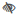
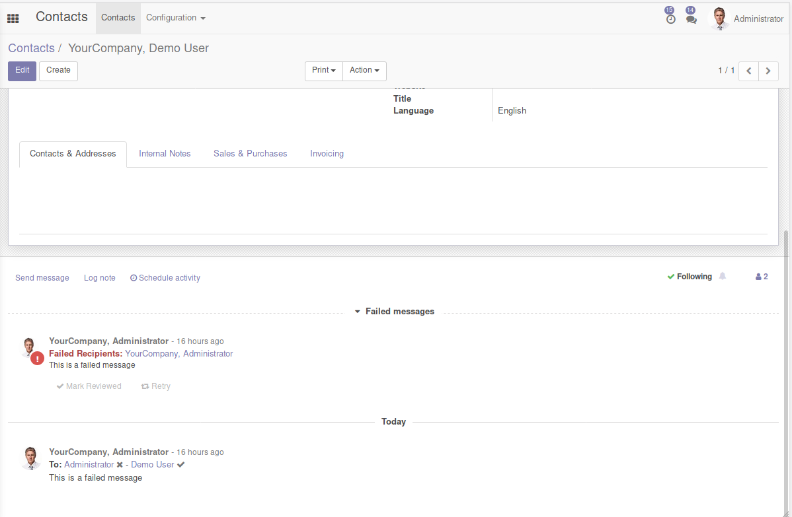
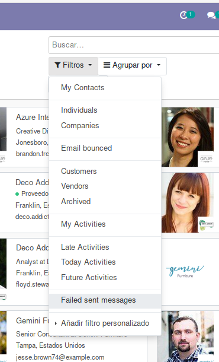

When user sends a message in mail_thread (chatter), for instance in
partner form, then an email tracking is created for each email
notification. Then a status icon will appear just right to name of
notified partner.

These are all available status icons:

 **Unknown**: No email tracking
info available. Maybe this notified partner has 'Receive Inbox
Notifications by Email' == 'Never'

 **Waiting**: Waiting to be
sent

 **Error**: Error while sending

 **Sent**: Sent to SMTP server
configured

 **Delivered**: Delivered
to final MX server

 **Opened**: Opened by partner

 **Cc**: It's a Carbon-Copy recipient.
Partners added in Cc get their own email, so their status is shown next
to the Cc icon. For Cc email addresses without their own email, the
status can't be known, so only the Cc icon is shown.

 **No Email**: The partner
doesn't have a defined email

 **No Partner**: The
recipient doesn't have a defined partner

If you want to see all tracking emails and events you can go to

- Settings \> Technical \> Email \> Tracking emails
- Settings \> Technical \> Email \> Tracking events

When the message generates an 'error' status, it will appear on the
'Failed' tab of the messaging menu. Any view with chatter can show the
failed messages too.

- Chatter

  

You can use "Failed sent messages" filter present in all views to show
records with messages in failed status and that needs an user action.

- Filter

  
